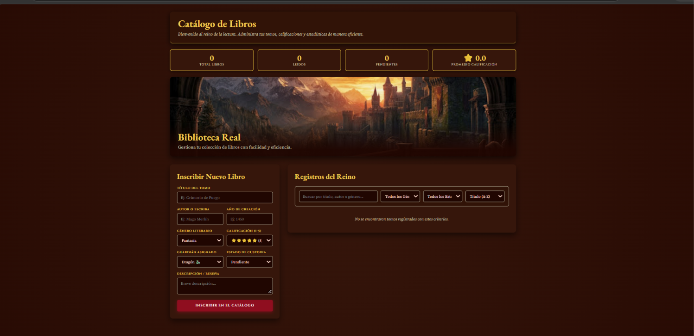
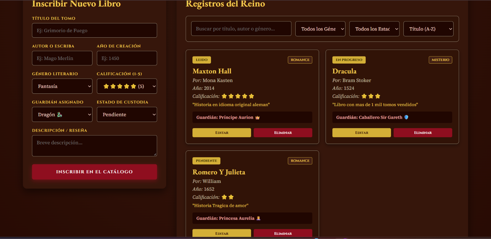
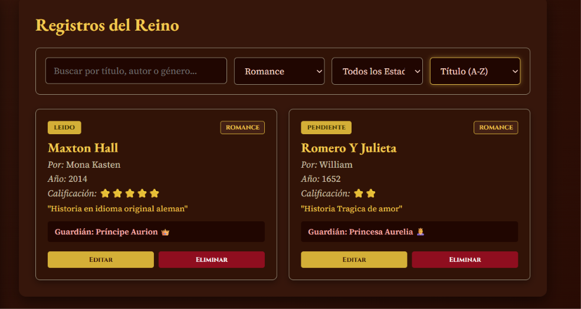

#  Catálogo del Reino — Sistema de Gestión de Biblioteca Medieval

Aplicación web desarrollada como parte de la práctica de la carrera de Ingeniería en Desarrollo de Software (UNIVO). El sistema implementa la arquitectura **MVC (Model-View-Controller)** en **TypeScript** con programación orientada a eventos para la administración y custodia de una biblioteca de fantasía medieval.

---

##  Enlace en Línea (GitHub Pages)
Puedes probar la aplicación directamente en tu navegador haciendo clic en el siguiente enlace:
 **[Ver Aplicación en Vivo](https://TU_USUARIO.github.io/TU_REPOSITORIO/)** 
---

##  ¿Qué hace la aplicación?

El sistema gestiona de forma completa los registros de la biblioteca mediante las siguientes características:

- **CRUD Completo:** Inscribir nuevos tomos, editar registros existentes con carga dinámica en el formulario, y eliminar tomos de forma segura con ventana de confirmación.
- **Panel de Estadísticas en Tiempo Real:** Contadores automáticos que muestran el total de libros, leídos, pendientes y el promedio general de calificación en estrellas.
- **Búsqueda y Filtros Combinados:** Búsqueda en tiempo real por texto (título, autor o género), combinada con selectores por género literario y estado de custodia.
- **Ordenamiento Dinámico:** Permite ordenar los tomos por título (A-Z / Z-A) o por año de creación (más reciente / más antiguo).
- **Persistencia de Datos:** Almacenamiento local mediante `localStorage` para conservar la información al recargar el navegador.

---

## Tecnologías Utilizadas

- **HTML5 & CSS3:** Estilos personalizados con paleta temática medieval (caoba, vino y oro), diseño responsivo y tipografías de Google Fonts.
- **TypeScript:** Aplicación de clases, interfaces, tipado estricto y separación modular bajo MVC.
- **LocalStorage API:** Persistencia de datos del lado del cliente.

---

## Capturas de Pantalla del Sistema

### 1. Vista Inicial (Interfaz Vacía y Panel de Estadísticas)


### 2. Vista con Libros Registrados, Filtros y Calificaciones

### 3. Barra de Búsqueda, Filtros Múltiples y Ordenamiento


---

##  Instrucciones para Ejecución Local (Para el Profesor)

Si deseas probar y evaluar el código fuente directamente en tu equipo, tienes dos opciones:

### Opción A: Descargar el ZIP
1. Haz clic en el botón verde **Code** arriba en este repositorio y selecciona **Download ZIP**.
2. Descomprime el archivo y abre la carpeta resultante en **Visual Studio Code**.

### Opción B: Clonar el repositorio
1. Abre tu terminal y ejecuta:
   ```bash
   git clone [https://github.com/TU_USUARIO/TU_REPOSITORIO.git](https://github.com/TU_USUARIO/TU_REPOSITORIO.git)
   cd TU_REPOSITORIO